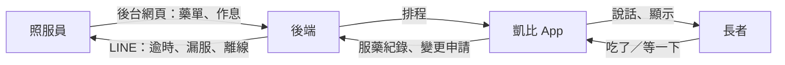

# 用藥提醒 App（KebbiMed）

裝在凱比機器人（Nuwa Kebbi **AIR-H300**）上的 Android App。時間到了，凱比會說話、顯示該吃的藥，提醒長者按時吃藥；照服員在後台管理藥單，長者沒吃藥時會收到 LINE 通知。

## 功能

- **長者**：時間到，凱比說話並顯示這包藥，按「吃了」或「等一下」。吃了花就長大，全部吃完開花。沒吃會再提醒，逾時、漏服都會記下來。
- **在凱比上改藥單**：拍藥袋加藥、刪除藥品、改吃藥時間。這些都是送「變更申請」給後台，App 不會自己改提醒。
- **照服員**：在後台網頁配對凱比、管理藥單、設定提醒參數；長者逾時沒吃、漏服、凱比離線時收到 LINE。凱比上的「照服員設定」要按住 3 秒才進得去。

## 運作方式



- **排程只從後端來。** 凱比上的加藥、停藥、改時間都送申請給後端，後端套用後凱比再拉回新排程。
- **計時在凱比本機**，斷網也會準時提醒；服藥紀錄先存在凱比上，有網路再補送。
- **後端負責正式紀錄和通知**：依凱比的回報判定準時、晚吃、漏服，並發 LINE 給照服員。
- 後端由第三方依 `:api` 模組實作。

## 版本

|  | debug 版 | 正式版（release） |
|---|---|---|
| 後端 | 測試環境 `nt-test.foodplus.com.tw` | 正式環境 `staging-healthplus.cip.gov.tw` |
| 測試工具（假後端、快轉時間、測試圖片） | 有 | 沒有 |
| 簽章 | 電腦上的 debug 金鑰 | 正式金鑰（`keystore/`，不在 git 裡） |

目前版本：1.0.0（`versionCode` 3）。

## 快速開始

需要 JDK 17 或 21、Android Studio，以及 Nuwa SDK 的 `.aar`（授權不能放進公開 repo，從 https://dss.nuwarobotics.com/ 下載後放進 `app/libs/`）。

```
./gradlew :app:assembleDebug                  # debug 版
./gradlew :app:assembleRelease                # 正式版（要有 keystore/）
./gradlew :api:test :app:testDebugUnitTest    # 單元測試
adb install -r app/build/outputs/apk/debug/app-debug.apk
```

模擬器、凱比的 USB 偵錯、正式簽章、從 debug 版換成正式版的步驟，見 `docs/工程師交接.md` 第 12 節。

## 專案結構

| 位置 | 內容 |
|---|---|
| `api/` | 凱比會呼叫的 13 支後端 API、資料格式、提醒規則（純 Kotlin，後端照這裡實作） |
| `app/` | 凱比上的 App：提醒引擎、同步、Nuwa 語音、掃藥袋、畫面 |
| `docs/工程師交接.md` | 給 App 工程師：架構、凱比的限制、測試方式、建置與發版、還沒做的 |
| `docs/後端接口文件.md` | 給後端工程師：資料庫、API、計算規則、LINE 通知 |

## 限制

- 只跑在凱比 AIR-H300（Android 15）上。凱比沒有 Google Play 服務，也沒有 Android 語音引擎，說話用 Nuwa SDK。
- App 要一直開在畫面上（取代凱比臉）。重開機、按 Home 或 App 當掉後不會自己回來，要點通知或用 RoFlow 打開。
